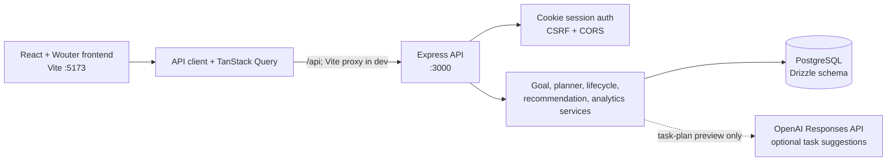

# PathPilot AI System Architecture

This reference was prepared from the checked-in frontend, API, service, schema, migration, test, and workspace configuration files. It describes source behavior; it does not establish the current state of a running database or external OpenAI account. No database was queried while preparing it.

## 1. System overview

PathPilot is a React single-page application served by Vite and an Express API. The browser calls `/api/*` on the same origin in the configured development setup; Vite proxies those requests to the API on port 3000. The API uses a PostgreSQL connection through `pg` and Drizzle ORM. Goal plans, task states, progress events, session records, milestones, and plan snapshots are PostgreSQL-backed. Recommendations are calculated by deterministic TypeScript rules. Goal task suggestions can use the OpenAI Responses API, with a deterministic fallback.



## 2. Frontend pages and navigation

Routes are selected in `artifacts/pathpilot-ai/src/App.tsx` inside an authenticated Wouter router. `GoalProvider` loads the signed-in user’s goals and profile preferences, and stores the selected goal ID in browser `localStorage` as `pathpilot-selected-goal`.

| Route | Page/component | Responsibility and main data |
|---|---|---|
| `/` | `Dashboard` in `src/App.tsx` | Overview cards, selected-goal trajectory/deadline, Today’s Work, and top recommendation signals. Reads goals, roadmap, progress, and recommendation APIs. |
| `/goals` | `GoalsPage` and `GoalCard` in `src/App.tsx` | Goal Studio form, AI/fallback task preview, user review, goal creation and deletion, goal selection. |
| `/roadmap` | `RoadmapPage` in `src/App.tsx`; lazy `SmartRoadmapPage` in `src/pages/roadmap-smart.tsx` | Dependency-aware task states, risk estimate, alternatives preview/application, replan preview/application, and complete/miss controls. |
| `/progress` | `ProgressPage`/`GoalProgressPage` in `src/App.tsx`; lazy `StudyAnalyticsPage` in `src/pages/study-analytics.tsx` | Study-session recorder, charts and summaries, followed by selected-goal workload, weekly outcomes, topics, milestones, and plan history. |
| `/recommendations` | `RecommendationsPage` in `src/App.tsx` | Lists up to four deterministic priority signals for the selected goal. Its focus control saves one pending task selection in browser storage scoped by authenticated user and selected goal. |
| `/profile` | `ProfilePage` in `src/pages/profile.tsx` | Name, study preferences, and password updates. |
| `/signin`, `/signup`, `/` when signed out | `AuthGate`, `AuthPage`, `WelcomePage` in `src/App.tsx` | Session check and account entry. Unauthenticated protected-route navigation redirects to sign-in. |

Shared UI includes `TaskActions`, `StatusPill`, `ProgressBar`, `PageIntro`, loading/error states, and the authenticated shell/navigation in `src/App.tsx`. `src/main.tsx` mounts React and a top-level error boundary. `src/pages/roadmap-smart.tsx` uses its own task cards and replan/alternative dialogs.

## 3. API, authentication, and isolation

`artifacts/api-server/src/app.ts` installs request logging, strict CORS, cookie parsing, JSON/form parsing, and CSRF validation, then mounts the router at `/api`. `routes/index.ts` registers health, auth, study analytics, profile, and PathPilot routers. The PathPilot and profile routers apply `requireAuth`; Study Analytics injects the same middleware into its router. Sign-in and sign-up are intentionally public.

`lib/auth.ts` stores a random session token only as a SHA-256 hash in `pathpilot_sessions`; the browser receives the token in an HTTP-only, same-site lax cookie (secure in production). Normal sessions last 8 hours; “remember me” sessions last 30 days. Passwords are hashed using Node `scrypt` with fixed parameters. The profile password change replaces the user’s sessions transactionally. CORS/CSRF configuration allows the development frontend origins by default and requires explicit `FRONTEND_ORIGINS` in production.

The API derives the authenticated user from the session rather than trusting an incoming user ID. Goal queries filter by `req.auth.id`; goal-specific writes first establish goal ownership. Task lifecycle checks task ownership through its goal while holding the task row lock. Study-session operations use the authenticated user ID, validate optional goal ownership, and serialize checks/inserts with a per-user row lock. The frontend API client includes browser cookies where configured.

### API route inventory

All paths below are prefixed by `/api`.

| Route | Responsibility |
|---|---|
| `GET /healthz` | Health response; does not represent full DB readiness. |
| `GET /auth/session`, `POST /auth/signup`, `POST /auth/signin`, `POST /auth/signout` | Session lookup, account creation, sign-in, and sign-out. |
| `GET /profile`, `PATCH /profile`, `PATCH /profile/preferences`, `POST /profile/password` | Read/update profile, daily study preferences, and password. |
| `POST /goals/task-plan-preview` | Generate/validate suggestions without saving a goal. |
| `GET /goals`, `POST /goals`, `DELETE /goals/:goalId` | List summaries, create a goal with user-confirmed tasks, and atomically delete goal-owned records. |
| `POST /goals/:goalId/generate-roadmap`, `GET /goals/:goalId/roadmap`, `GET /goals/:goalId/smart-roadmap` | Schedule, retrieve, and explain a selected goal’s route. |
| `POST /goals/:goalId/preview-alternatives`, `POST /goals/:goalId/apply-alternative` | Compare proposed capacity/deadline options and apply a fresh, fingerprint-checked choice. |
| `POST /goals/:goalId/replan-preview`, `POST /goals/:goalId/replan` | Preview and then apply replan/recovery of missed tasks using a fingerprint token. |
| `GET /goals/:goalId/progress`, `GET /goals/:goalId/progress-dashboard` | Current selected-goal summary and history-derived weekly/topic/milestone/timeline data. |
| `POST /goals/:goalId/milestones` | Save a confirmed milestone after validating its task IDs belong to the goal. |
| `GET /goals/:goalId/recommendations` | Return deterministic ranked active task signals. |
| `POST /tasks/:taskId/complete`, `POST /tasks/:taskId/miss` | Perform an authorized lifecycle transition and append a progress event. |
| `GET /study-analytics`, `POST /study-sessions` | Read user analytics and record an idempotent completed session. |

Request/response validation for PathPilot endpoints is defined in `lib/api-zod`; generated query hooks/types live in `lib/api-client-react/src/generated`. Study Analytics has its focused client in `lib/api-client-react/src/study-analytics.ts`.

## 4. PostgreSQL model and relationships

The Drizzle schema is in `lib/db/src/schema`. Foreign keys below use PostgreSQL’s default delete behavior unless explicitly stated. Goal deletion is implemented explicitly in `artifacts/api-server/src/lib/pathpilot/goal-deletion.ts`, in one transaction deleting dependent links/events/snapshots before tasks and goal.

| Table | Key columns / relationships | Features |
|---|---|---|
| `pathpilot_users` | `id`, `name`, nullable `email` and `password_hash`, `available_hours`, preferred start/end. Partial unique index on `lower(email)` when email is non-null. | Authentication, ownership root, profile/preferences. |
| `pathpilot_sessions` | `user_id → pathpilot_users.id`, unique `token_hash`, expiry, remember flag, created/last-used timestamps. | Cookie sessions. |
| `pathpilot_goals` | `user_id → users.id`; name/type/deadline/daily hours/priority/description/skills. | Goal Studio, schedule constraints, recommendation inputs. |
| `pathpilot_tasks` | `goal_id → goals.id`; task name/topic/duration/priority/difficulty/status/scheduled date/completion percent/completed date. | Roadmap, current progress, estimates, scheduling and recommendations. |
| `pathpilot_dependencies` | `task_id → tasks.id`, `depends_on → tasks.id`; unique pair and check preventing self-dependency. | Prerequisite graph used by planner and smart roadmap. |
| `pathpilot_progress` | `user_id → users.id`, `task_id → tasks.id`, date, status, completion percent; non-unique lookup index. | Historical completed/missed/recovered events, activity history, weekly outcomes and completion dates. |
| `pathpilot_plan_versions` | `goal_id → goals.id`, version, saved daily hours/deadline/created timestamp; unique `(goal_id, version)`. | Version history whenever material planning inputs/schedule change. |
| `pathpilot_plan_version_tasks` | `plan_version_id → plan_versions.id`, `task_id → tasks.id`, planned date and snapshot name/topic/duration; unique `(plan_version_id, task_id)`. | Historical planned dates and workload estimates. Completion state/date is not snapshotted here. |
| `pathpilot_milestones` | `goal_id → goals.id`, title, optional target date, confirmation timestamp. | Confirmed goal checkpoints. |
| `pathpilot_milestone_tasks` | `milestone_id → milestones.id`, `task_id → tasks.id`; unique pair. | Tasks attached to a milestone. |
| `pathpilot_study_sessions` | `user_id → users.id`, nullable `goal_id → goals.id ON DELETE SET NULL`, UUID request ID, UTC-capable start/end/create timestamps; unique `(user_id, request_id)`, duration check 1 minute–12 hours, indexes by user/start, user/end, and goal. | Recorded study sessions; separate from auth sessions and task estimates. |

The code schema and migration files describe intended structure, not whether every migration has run in any particular local database. `lib/db/migrations/0001_add_auth_sessions.sql` and `0002_add_study_sessions.sql` are operator-applied SQL; the Study Sessions migration is explicitly guarded for review/approval in its comments and has no automatic application in the API startup path.

## 5. Goal creation and task suggestions

Goal Studio (`GoalsPage` in `artifacts/pathpilot-ai/src/App.tsx`) validates required name, deadline, and description in the UI. It submits the goal inputs to `POST /api/goals/task-plan-preview`. The authenticated PathPilot router calls `getTaskPlan` in `routes/pathpilot.ts`, which reads `OPENAI_API_KEY` and invokes `generateGoalTasks`.

When configured, `openai-task-provider.ts` calls the OpenAI Responses API using `OPENAI_MODEL`, defaulting to `gpt-4o-mini`. It requests structured output matching `AiTaskPlanSchema`, with no retries and a 15-second timeout. The provider bounds prompt text lengths and tells the model to use supplied topics, reflect constraints/priority, and return prerequisite indexes. The output validator in `task-generation.ts` accepts 1–20 tasks, constrains names/topics/durations/priority/difficulty/dependency indexes, verifies topics are among supplied skills, rejects duplicate task names/dependencies and dependency cycles, then prefixes the task name with its topic.

If the key/provider is missing, the provider errors, or the response is invalid, a deterministic fallback creates one task per skill (or “First milestone” when no skills are supplied). Fallback names append “foundations” unless the skill contains “practice”; durations are `min(4, max(1, 2 + (index mod 3)))` hours; first task gets high priority/hard difficulty and later tasks medium/medium; fallback tasks have no dependencies. These hours are a generic index-based rule, not personalized from history or daily-hours capacity. AI-proposed hours are generated by the external model and validated to 0.5–100 hours; there is no trained model in the repository.

The UI lets the user review/edit each suggested task name and topic before confirmation; suggestions are not saved by preview. `POST /api/goals` is protected by `requireConfirmedTaskPlan`, inserts the goal, task rows, and dependency edges, then calls `scheduleGoal`. The UI selects the new goal and invalidates goal/roadmap caches.

## 6. Roadmap scheduling and plan history

`planner-core.ts` contains the pure scheduler. It starts on the current UTC calendar date and includes the deadline date. It schedules pending tasks only, ordering by `(priority weight × 10) + (difficulty weight × 2)` (high/medium/low weights 3/2/1; hard/medium/easy 3/2/1). A task can be selected when all prerequisite task IDs are already completed or placed. Completed tasks count as already placed. Each task is indivisible: its duration must fit the daily capacity; remaining capacity is carried to later tasks on that day, and a new day starts when the target is filled or the next task does not fit. An over-capacity task is reported as `exceeds_daily_capacity`; finite deadline exhaustion as `deadline_capacity`; blocked descendants as `dependency_unavailable`.

`scheduleGoal` in `planner.ts` locks the goal row, validates any expected plan fingerprint, optionally patches the goal constraints, optionally resets missed tasks to pending and inserts `recovered` events, calls the scheduler, and updates pending tasks’ `scheduled_date`. Completed tasks are not rescheduled. It snapshots all task IDs, current schedule/name/topic/duration and goal daily-hours/deadline when `isMaterialPlanChange` detects a meaningful difference. This preserves historical planned values but not historical completion state.

`GET /goals/:goalId/smart-roadmap` builds task state labels and workload risk without writes. Risk uses unfinished task estimates, theoretical capacity of `max(0, daysUntil(deadline) + 1) × dailyHours` (UTC calendar days including today through the deadline), and the scheduler’s actual feasibility result. The route’s assumptions and task fingerprint are returned to the frontend.

Comparison previews use `previewAlternativePlans` with the same scheduler. Current constraints are compared with daily hours increased by at least one hour and enough to fit the longest individual task (capped at 8 hours), and deadline extended by 14 days. Tasks are not split. Feasibility requires no scheduler infeasible tasks and every pending task to have a date. Feasible options are ranked by a deterministic score combining constraint change, deadline extension, schedule churn/date movement and a capacity realism cost above 4 hours/day. The preview is read-only. Applying an option verifies the fingerprint and calls `scheduleGoal` with the proposed goal patch.

Replan preview treats missed tasks as pending in memory only. Applying requires its fingerprint; it resets missed task status/percent/completed date, inserts `recovered` events, reschedules pending tasks, and creates a plan version only for a material change. Completed task rows and dependency edges remain unchanged by scheduling.

## 7. Task lifecycle and Overview synchronization

The Overview’s `TaskActions` invokes `useCompleteTask` or `useMissTask` with the task ID. API routes in `routes/pathpilot.ts` convert the current UTC date and call `transitionTaskStatus` in `task-lifecycle.ts`. The service locks the task, verifies ownership via its goal, permits pending→completed, pending→missed, completed→missed, and missed→completed, and writes task state plus a progress event in the same transaction. Repeating the same target status is idempotent: it adds no event and does not change `completed_at`. Marking missed clears that column; later completion sets it to the new date. Replanning missed tasks separately records `recovered` and resets them to pending.

Successful task actions invalidate the relevant roadmap/progress/recommendation/goal queries. Overview then renders a new response from `GET /api/goals/:goalId/roadmap` and progress endpoints.

The authenticated `GoalProvider` shares the focus task ID between `RecommendationsPage` and `Dashboard`. It persists one ID under a local-storage key scoped to the authenticated user ID and selected goal ID, reloads it when the goal changes, and listens for browser `storage` events from other tabs. Recommendations can select only a task that is still pending in the selected goal’s current roadmap; selecting another task replaces the saved selection and selecting the active task clears it.

Overview’s `Dashboard` fetches the selected-goal roadmap and keeps its existing schedule selection (up to four tasks scheduled today, or up to four pending scheduled tasks if none are scheduled today). A valid selected focus task is moved to the first position, or prepended if it is not already in that scheduled list; scheduled items remain visible. If the saved ID is missing, belongs to another goal, or is no longer pending, it is removed and the normal scheduled list is shown. This browser-local preference does not change status, schedule, priority, dependencies, progress history or plan versions. It does not synchronize across devices or browsers.

## 8. Recommendations and ranking

`GET /api/goals/:goalId/recommendations` is authenticated and selected-goal-scoped. `prioritizeTasks` in `smart-roadmap.ts` considers non-completed tasks, dependencies, priority, deadline urgency, scheduled day, duration fit, and how many downstream tasks a task unlocks. Score terms are: base priority 30/20/10 for high/medium/low; urgency 42 if deadline is due/past, 34 within 3 days, 24 within 7, 14 within 14; +28 overdue; +9 per downstream unlock; +4 when the duration fits the daily target; +12 for an overloaded scheduled day; +8 if scheduled today; −1000 if blocked. Blocked tasks are then excluded. Results sort by score descending, shorter duration, then ID; the endpoint returns the first four with reason text. No recommendation is persisted, and recommendation display itself does not apply a replan or mutate tasks.

`Dashboard` also reads this endpoint to render its top three signals. The focus selection is separate from recommendation ranking and does not alter that endpoint’s result.

## 9. Study Analytics

The page is `artifacts/pathpilot-ai/src/pages/study-analytics.tsx`; pure validation/range/streak/insight rules are in `artifacts/api-server/src/lib/study-analytics.ts`; SQL is in `study-repository.ts`; request orchestration is in `routes/study-analytics.ts`.

`POST /api/study-sessions` accepts a UUID-v4 request ID, optional owned goal ID, and explicit UTC start/end ISO timestamps. Only completed sessions from the last 366 days are accepted; duration is 1 minute–12 hours. Per-user request IDs are idempotent for identical payloads; changed payload reuse is 409. Overlap intervals are rejected with strict interval intersection, so adjacent sessions are valid. A per-user row lock serializes this check and insert. Duration is always calculated from timestamps, not a caller-provided field.

`GET /api/study-analytics` accepts week, last-week, 30-days, or custom UTC calendar ranges (max 366 days, inclusive display dates). SQL clips sessions to the selected half-open range and splits minutes by UTC day. Session count/average include only records whose end time falls in the range; average uses their full durations. Task completions are distinct task IDs with completed progress events dated in range. Current task progress/status and goals are current-state data; target hours comes from the current user setting. Current streak scans all sessions through today/yesterday in UTC and is independent of the selected range.

The UI shows recorded minutes, completed-session count, average duration, completed tasks in range, current completion percentage, active goals, current streak, and current configured target. Charts are daily recorded minutes, current task-state counts, and a study-minute trend (shown with at least 7 days and activity on at least 4 days); a daily accessible table lists minutes and distinct tasks completed. Insights use deterministic threshold/date rules, not AI. Goal/deadline summaries reflect current goal/task data. Activity history combines overlapping sessions and date-only completed/missed/recovered events, newest first, page size 50. Cross-boundary sessions display full duration in history even though the chart clips them.

The SQL repository directly requires `public.pathpilot_study_sessions`; the source does not silently fall back when its migration is absent. The schema/migration files alone do not prove the local DB has that table.

## 10. Progress, milestones, and planned-versus-completed analytics

`GET /goals/:goalId/progress` summarizes current task state for the selected goal: clamped mean task `completion_percent`; counts by current status; total estimated task hours; and estimated hours for currently completed tasks.

`GET /goals/:goalId/progress-dashboard` reads selected-goal progress events, plan-version snapshots, milestones, links, and current tasks. `weeklyProgress` emits the last 8 Monday–Sunday UTC weeks. It deduplicates task IDs separately per completed/missed event type; one task with both event types contributes to both and thus twice to the displayed rate denominator. `recovered` events do not cancel missed events. Weekly planned hours/count use the latest snapshot available by the end of that week; weekly actual session hours are intentionally unavailable (`null`).

Topic progress groups current tasks by topic; percent is currently completed tasks divided by all topic tasks. Confirmed milestones use the rule “all linked tasks currently completed.” Suggested milestones are unconfirmed deterministic task groups by topic with the latest scheduled task date as target. The timeline combines each snapshot’s stored planned dates/estimates with the task’s current completed date or latest completed progress-event date. Completion is not stored per snapshot, so an eventual completion date can appear for several historical versions.

## 11. External services, libraries, algorithms, configuration

**External service:** OpenAI Responses API for optional task suggestions only. `OPENAI_API_KEY` enables the call; `OPENAI_MODEL` selects a model and defaults to `gpt-4o-mini`. The code does not train or host an ML model. Deterministic fallback task suggestions, scheduling, risk, recommendations, progress, and insights are implemented in TypeScript.

**Core libraries actually used:** React/React DOM, Wouter, TanStack React Query, generated API hooks/custom fetch, Recharts, Zod, Express 5, `pg`, Drizzle ORM, OpenAI SDK, Node crypto `scrypt`, Tailwind CSS v4/Vite plugin, Vite, and Replit development plugins. The API package declares `bcryptjs`, but the checked auth implementation uses Node `scrypt`; the declaration alone is not evidence that bcrypt is used.

**Environment/configuration read in source:**

| Variable | Use |
|---|---|
| `DATABASE_URL` | Required by `lib/db/src/index.ts` for the PostgreSQL pool; Drizzle config also requires it. |
| `PORT` | Required by API and Vite config; API listens on it, Vite uses it for frontend dev/preview. |
| `BASE_PATH` | Required by Vite config for app base path. |
| `NODE_ENV` | Production cookie security, explicit frontend-origin requirement, CORS/CSRF behavior, and Vite dev-plugin selection. |
| `FRONTEND_ORIGINS` | Production allowlist for browser origins; development has localhost defaults. |
| `OPENAI_API_KEY` | Optional task-suggestion provider credential. Never document its value. |
| `OPENAI_MODEL` | Optional model name; default `gpt-4o-mini`. |
| `LOG_LEVEL` | Pino logger level, default `info`. |
| `REPL_ID` | Enables Replit Cartographer/dev-banner Vite plugins outside production. |

`pnpm-workspace.yaml` defines workspace packages/catalog, `minimumReleaseAge: 1440`, approved built dependencies and platform-specific optional dependency exclusions. In particular, this checked-in configuration excludes `@tailwindcss/oxide-win32-x64-msvc`; Rollup/Lightning CSS platform exclusions are also present. This affects Windows native dependency installation, not PathPilot’s runtime scheduling rules. Do not infer installed package state from manifest/lockfile alone.

## 12. Feature-to-file map

| Capability | Main implementation files |
|---|---|
| App shell, routing, overview, Goal Studio, old progress ledger, recommendation screen | `artifacts/pathpilot-ai/src/App.tsx` |
| Smart Roadmap UI | `artifacts/pathpilot-ai/src/pages/roadmap-smart.tsx` |
| Study Analytics UI | `artifacts/pathpilot-ai/src/pages/study-analytics.tsx` |
| Profile UI/client | `artifacts/pathpilot-ai/src/pages/profile.tsx`, `src/lib/profile.ts` |
| OpenAI task suggestions and fallback | `artifacts/api-server/src/lib/pathpilot/openai-task-provider.ts`, `task-generation.ts`; `routes/pathpilot.ts` |
| Scheduling and plan snapshots | `artifacts/api-server/src/lib/pathpilot/planner-core.ts`, `planner.ts`, `planning-explanations.ts`, `plan-fingerprint.ts` |
| Ranking and workload risk | `artifacts/api-server/src/lib/pathpilot/smart-roadmap.ts` |
| Task lifecycle and recovery | `artifacts/api-server/src/lib/pathpilot/task-lifecycle.ts`, `planner.ts`, `routes/pathpilot.ts` |
| Progress, weekly/topic/milestone/timeline calculations | `artifacts/api-server/src/lib/pathpilot/progress-analytics.ts`, `routes/pathpilot.ts` |
| Study recording and analytics | `artifacts/api-server/src/lib/study-analytics.ts`, `study-session-service.ts`, `study-repository.ts`, `routes/study-analytics.ts` |
| Authentication/security | `artifacts/api-server/src/lib/auth.ts`, `request-security.ts`; `routes/auth.ts`, `routes/profile.ts` |
| Database schema/config/migrations | `lib/db/src/schema/*`, `lib/db/src/index.ts`, `lib/db/migrations/*`, `lib/db/drizzle.config.ts` |
| API request/response schemas/client | `lib/api-zod/src/*`, `lib/api-client-react/src/*`, `lib/api-spec/openapi.yaml` |

## 13. Sequence diagrams

### Goal creation and AI task suggestions

```mermaid
sequenceDiagram
  actor User
  participant UI as Goal Studio
  participant API as POST /api/goals/task-plan-preview
  participant Gen as generateGoalTasks
  participant AI as OpenAI Responses API
  participant Create as POST /api/goals
  participant DB as PostgreSQL
  participant Plan as scheduleGoal/buildSchedule
  User->>UI: Submit goal details
  UI->>API: Goal fields and skills
  API->>Gen: Generate preview
  opt API key/provider configured
    Gen->>AI: Structured task plan request
    AI-->>Gen: Candidate tasks
  end
  Gen-->>UI: Validated suggestions or deterministic fallback
  User->>UI: Review/edit names/topics and confirm
  UI->>Create: Goal + confirmed tasks
  Create->>DB: Insert goal, tasks, dependencies
  Create->>Plan: Schedule confirmed tasks
  Plan->>DB: Update scheduled dates and save material plan snapshot
  Create-->>UI: Created goal and generation status
```

### Roadmap generation

```mermaid
sequenceDiagram
  participant UI as Goals/Roadmap UI
  participant API as PathPilot API
  participant Service as scheduleGoal
  participant Core as buildSchedule
  participant DB as PostgreSQL
  UI->>API: POST generate-roadmap (or create goal triggers scheduling)
  API->>Service: Owned goal ID
  Service->>DB: Lock goal; load tasks/dependencies
  Service->>Core: Constraints + UTC start date + tasks
  Core-->>Service: Scheduled dates and infeasibility reasons
  Service->>DB: Update pending dates; save version if materially changed
  API-->>UI: Roadmap and feasibility status
```

### Task completion

```mermaid
sequenceDiagram
  actor User
  participant UI as Overview/Roadmap TaskActions
  participant API as POST /api/tasks/:id/complete
  participant Life as transitionTaskStatus
  participant DB as PostgreSQL
  User->>UI: Complete task
  UI->>API: Task ID + authenticated cookie
  API->>Life: User-scoped transition and UTC date
  Life->>DB: Lock task; verify goal owner
  Life->>DB: Update task + insert completed progress event in transaction
  API-->>UI: Updated task
  UI->>UI: Invalidate roadmap, progress, recommendations and goal queries
```

### Study-session recording

```mermaid
sequenceDiagram
  actor User
  participant UI as StudyAnalyticsPage
  participant API as POST /api/study-sessions
  participant Service as recordStudySession
  participant DB as PostgreSQL
  User->>UI: Enter completed UTC interval and optional goal
  UI->>API: UUID request ID + start/end
  API->>API: Validate UTC, ownership fields and duration bounds
  API->>Service: Authenticated user + validated values
  Service->>DB: Lock user; check duplicate ID and overlap; check goal ownership
  Service->>DB: Insert session if new
  API-->>UI: Saved duration (or same-session idempotent response)
  UI->>API: GET /api/study-analytics after invalidation
```

### Queueing a recommendation

```mermaid
sequenceDiagram
  actor User
  participant Rec as RecommendationsPage
  participant State as GoalProvider focus selection
  participant API as GET /api/goals/:goalId/recommendations
  participant DB as PostgreSQL
  participant Overview as Dashboard
  participant Roadmap as GET /api/goals/:goalId/roadmap
  Rec->>API: Fetch ranked recommendations (authenticated, selected goal)
  API->>DB: Read selected-goal tasks and dependencies
  API-->>Rec: Up to 4 ranked task signals
  User->>Rec: Click “Queue this next”
  Rec->>Roadmap: Read current selected-goal roadmap for validation
  Roadmap-->>Rec: Current task IDs, goal IDs, and states
  Rec->>State: Save or clear user/goal-scoped task ID in local storage
  State-->>Overview: Shared context update; other tabs receive storage event
  Overview->>Roadmap: Independently fetch selected-goal schedule
  Roadmap-->>Overview: Tasks with scheduledDate/status
  Note over Overview: Validate pending task in roadmap, then prioritize it above scheduled work
```

## 14. Tests, known limitations, and presentation notes

Focused tests are in `artifacts/api-server/src/lib/pathpilot/*.test.ts` and `artifacts/api-server/src/lib/*study*.test.ts`; route/security/profile/auth tests sit alongside their modules. Frontend utility tests are in `artifacts/pathpilot-ai/src/lib/*.test.ts`. Tests cover pure scheduler behavior, task-generation validation/fallback, deterministic rankings, plan comparisons, lifecycle transitions and analytics calculations. They do not prove the installed PostgreSQL schema or live OpenAI configuration.

Known limitations/verification boundaries:

- Recommendation focus selection is browser-local, scoped by user and goal; it does not synchronize across devices or browsers and has no server/API/table persistence.
- Historical plan snapshots retain schedule/estimate data, but not task state as-of that snapshot; the timeline displays eventual completion information alongside old plans.
- Weekly outcome counts preserve historical missed/completed event presence; one task may contribute to both groups, and recovered is a separate ignored status for that percentage.
- Study session records are self-reported; there is no stopwatch or proof of study. Session history uses full durations while charts clip range boundaries.
- A source migration/schema definition does not confirm that a local database has been migrated. The current database state and any migration application must be checked separately and with appropriate approval.
- Task suggestion hours from the OpenAI path are model-produced values subject to range validation. The fallback has a simple repeating index formula. Neither path demonstrates model training or uses actual session history.
- The scheduler does not split tasks across days. Its estimates and risk checks depend on saved task hours and goal constraints.

Presentation talking points:

1. The system keeps task estimates, recorded study sessions, and completion events as distinct data sources.
2. The scheduler is deterministic and dependency-aware; task suggestions can be AI-assisted but must be reviewed before persistence.
3. Study Analytics combines UTC-clipped session history with clearly labeled current-state and event-history metrics.
4. Replanning is previewed against a plan fingerprint before applying, and plan snapshots preserve planned dates and estimates.
5. Recommendation focus selection is a browser-local user/goal preference that Overview validates against the current roadmap before prioritizing.

## Verified versus inferred

Statements above labeled as current implementation are directly supported by the checked-in code/schema/tests. Runtime availability, actual database migration state, live API credentials/model access, and real user row values were not checked.
